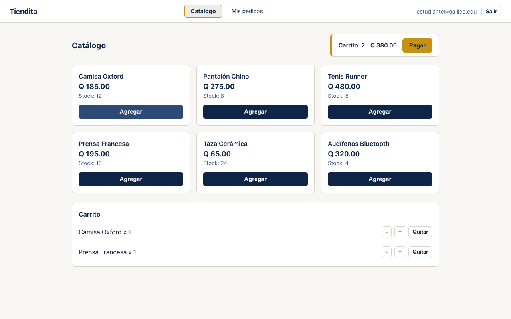

# Tiendita — PDDS Onramp

Los cinco badges arrancan en rojo a propósito. Este repositorio está hecho para ayudarte a preparar tu entrada al Posgrado en Diseño y Desarrollo de Software (PDDS) de Universidad Galileo, pasando cada paso a verde a tu ritmo. Todo gira alrededor de un solo proyecto, **Tiendita**, pero cada uno de los cinco pasos se puede trabajar de forma independiente y combina lectura de código ajeno, debugging y un cambio pequeño.

Así se ve el catálogo de Tiendita al terminar (hay más capturas en el [Paso 5](steps/05-react-deploy/README.md#referencia-visual)).

## Los 5 pasos (independientes)

| Paso | Enfoque | Guía |
| --- | --- | --- |
| Paso 1 | Flujo de trabajo, logs, Pull Requests y code review | [steps/01-terminal-git/README.md](steps/01-terminal-git/README.md) |
| Paso 2 | Reglas de negocio, estructuras de datos, debugging y testing | [steps/02-rules-algorithms/README.md](steps/02-rules-algorithms/README.md) |
| Paso 3 | Modelo relacional, consultas SQL y prevención de inyección SQL | [steps/03-sql/README.md](steps/03-sql/README.md) |
| Paso 4 | Arquitectura por capas, cliente-servidor, API REST y autorización | [steps/04-api-auth/README.md](steps/04-api-auth/README.md) |
| Paso 5 | Frontend en React conectado al API y deploy en Vercel y Neon | [steps/05-react-deploy/README.md](steps/05-react-deploy/README.md) |

## Cómo usar asistentes de IA

Puedes usar asistentes de IA mientras trabajas este onramp, siempre que te ayuden a aprender y no a saltarte el razonamiento.

1. Úsalos para entender mensajes de error, comparar alternativas o destrabarte después de leer `hints/1.md`.
2. Evita aceptar código que no puedas explicar con tus propias palabras.
3. Responde las tres preguntas de autoevaluación al inicio y al final de cada paso para comprobar si dominaste el concepto.

## Inicio rápido

1. Haz clic en **Use this template** en GitHub para crear tu copia del repositorio.
2. Abre la pestaña **Actions** en tu repositorio nuevo y ejecuta el workflow **Initialize Repo** (crea tus issues y actualiza los badges de arriba).
3. Abre el repositorio en **GitHub Codespaces** o clónalo en local con Python 3.12, `uv` y Node 22.
4. Verifica tu entorno con `make doctor` y elige el paso por donde quieras empezar.
5. Revisa tu avance en cualquier momento con `make progress` o valida un paso con `make check STEP=N`.

Si algún término de ingeniería resulta nuevo, consulta el [glosario](docs/glosario.md) y las guías en [examples/](examples/). Si quieres comparar tu trabajo, ver las respuestas de autoevaluación o las capturas de pantalla de cómo debería verse la aplicación, consulta el [repositorio de soluciones de referencia](https://github.com/ykro/pdds-onramp-solutions). Para dudas o compartir avances, usa la pestaña **Discussions** de este repositorio.

## Licencia

Publicado bajo licencia [MIT](LICENSE).
